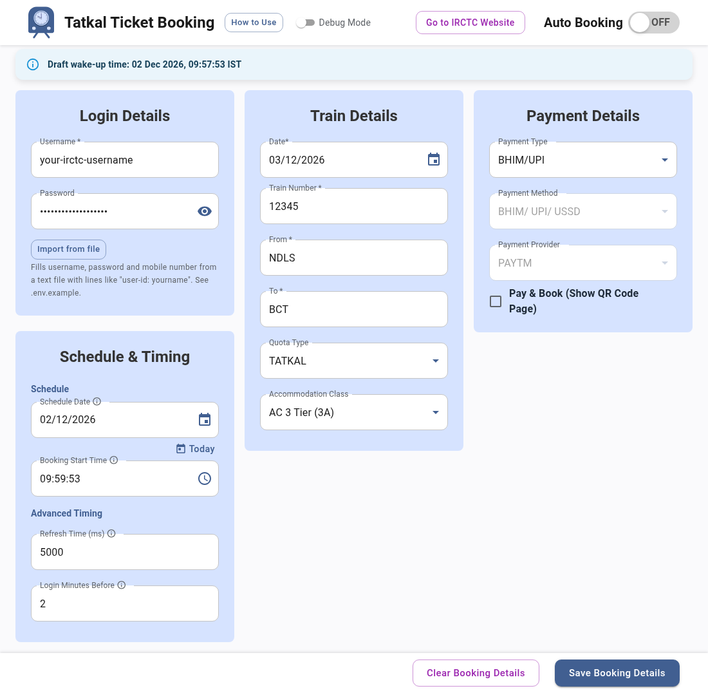
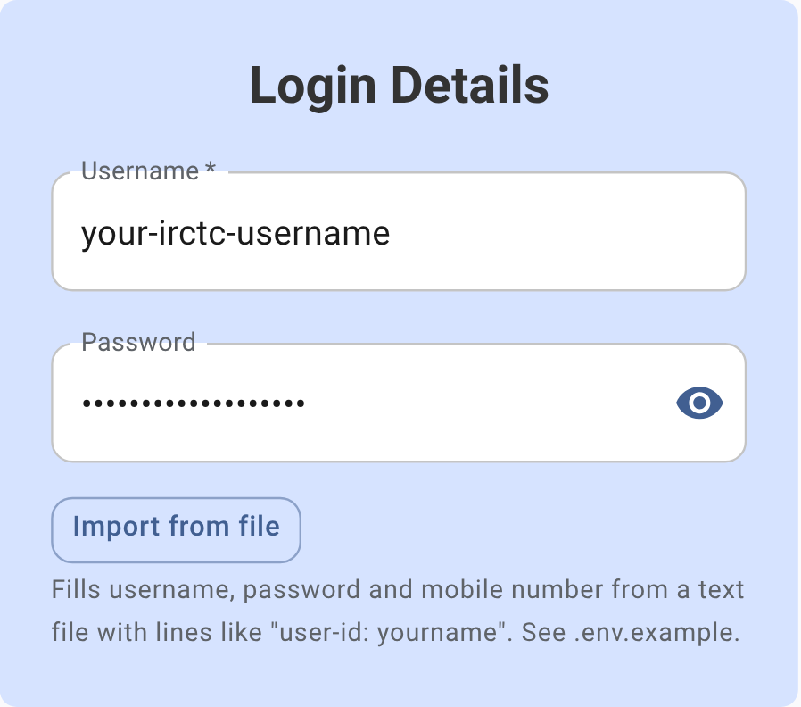
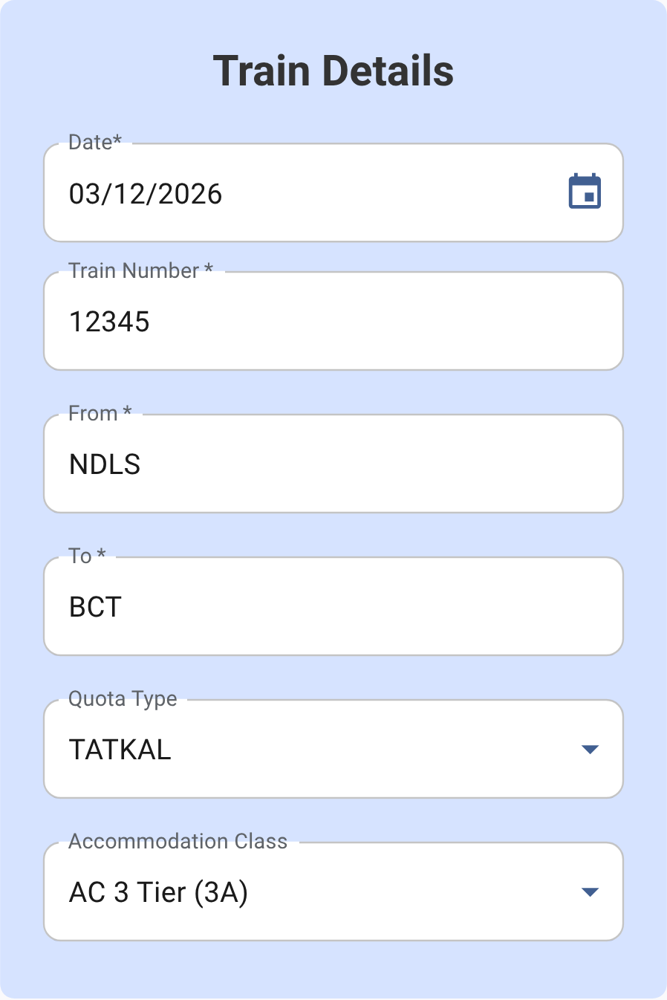
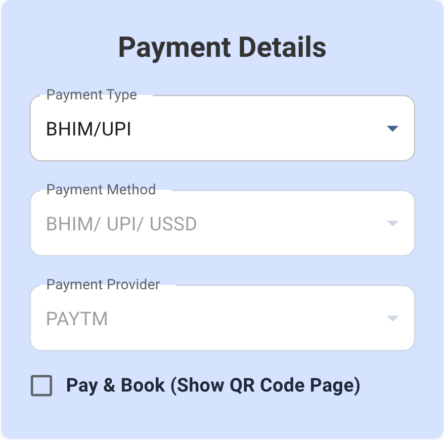
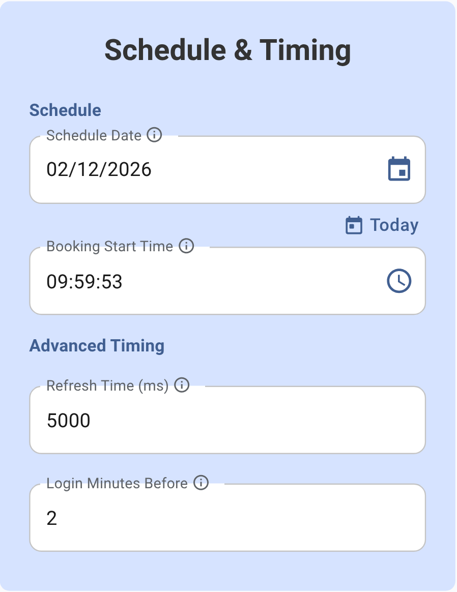
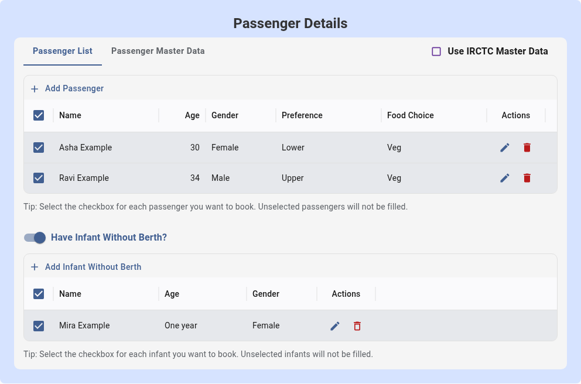
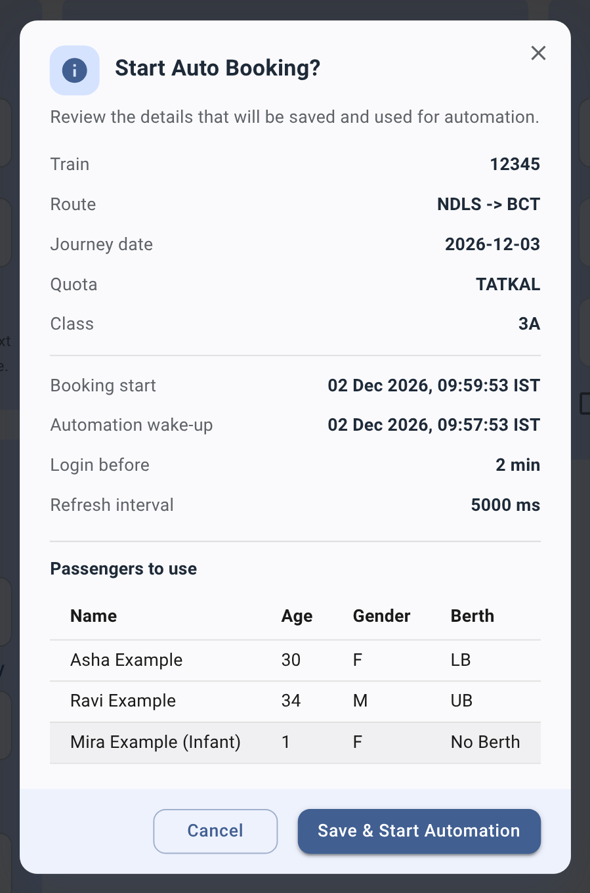
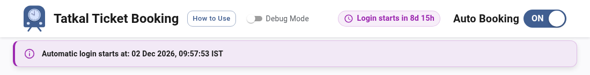

# Tatkal Ticket Booking: an IRCTC form filler for Chrome

An unofficial browser extension that fills in the IRCTC booking pages with details you save beforehand. You still type every captcha and any OTP. You also approve the payment, unless you choose **Wallets** and tick **Pay & Book (Direct Deduction)**: the extension then confirms the payment from your IRCTC eWallet itself. It is not connected with IRCTC and cannot promise a ticket.



## What it does

- Opens the IRCTC search page shortly before the **Booking Start Time** you set.
- Fills in your username and password.
- Fills in the journey and presses Search at that time.
- Opens your train and class, and presses Book Now when IRCTC allows it.
- Fills in passengers, mobile number and preferences.
- Selects your payment option, and presses Pay & Book if you ticked that box.

## What you still do yourself

- Type each captcha and press Enter.
- Read the seat status before going on to payment. The extension waits for you there only when IRCTC shows a captcha.
- Enter any OTP and approve the payment, except a wallet payment you told the extension to make (**Wallets** with **Pay & Book** ticked).
- Answer a pop-up when the extension cannot find something.
- Switch Auto Booking off afterwards.

## Limits and fair use

- This is an unofficial project, not affiliated with or endorsed by IRCTC.
- IRCTC's terms of service restrict automated booking, and IRCTC can restrict an account. Using the extension is your own decision and risk.
- This version has been checked only on a test copy of IRCTC's booking pages built for this project, not on the real site. IRCTC can also change its pages, and steps then stop working. Be ready to finish any step by hand.
- Use it for your own travel only, never for bulk booking or reselling tickets.
- There is no guarantee of a ticket.

## What you need

- **Google Chrome 120 or newer** on a laptop or desktop. Microsoft Edge loads extensions the same way, but this one has not been tried there.
- **An IRCTC account.**
- **Chrome running and the computer awake** when the extension is due to open IRCTC. If Chrome is closed or the computer is asleep then, IRCTC does not open on time.

It does not work in Firefox, in Safari, on phones or on the IRCTC beta site (addresses containing `/eticket/`).

## Install

1. Open the [latest release](https://github.com/rodosingh/irctc-tatkal-ticket-booking-extension/releases/latest). Under **Assets**, download `irctc-tatkal-ticket-booking-extension-v6.3.4.zip` (the number changes with each version). Do not take "Source code": it cannot be loaded.
2. Extract it into a folder you will keep, such as `Documents/tatkal-extension`. On Windows, right-click the zip and choose **Extract All**; on a Mac, double-click it. The browser runs the extension from this folder, so do not move, rename or delete it.
3. Check that `manifest.json` is directly inside (Windows may show it as just `manifest`). If your unzip tool made an inner folder, use that one.
4. Type `chrome://extensions` into the address bar and press Enter. In Edge, type `edge://extensions`.
5. Switch on **Developer mode** (top right in Chrome, left-hand menu in Edge). **Load unpacked** only shows while it is on.
6. Click **Load unpacked** and choose the folder from step 3. The picker lists folders only, so the right folder can look almost empty.
7. A tab named **Tatkal Ticket Booking** opens by itself. This is the options page.

To open it again later, click the extension's icon in the toolbar (it is under the puzzle-piece Extensions button until you pin it). Or, on the extensions page, click **Details** on the extension's card, then **Extension options**.

## Set up your booking

Do this on the options page before booking day. In a wide window, work across the top row of cards, then down; in a narrow one the cards stack, so go by their names.

A new install often shows a yellow line `Draft wake-up time has passed: ...` at the top; filling in the dates changes it. The **Go to IRCTC Website** button there only opens the site: nothing runs while **Auto Booking** is **OFF**.

1. **Login Details.** Type your IRCTC **Username** and **Password**. The password is kept unencrypted on this computer (see [Privacy](#privacy)); on a shared computer, leave it empty and sign in yourself on booking day. Or click **Import from file** and choose a plain text file like this (template: [`.env.example`](.env.example)):

   ```
   user-id: your-irctc-username
   password: your-irctc-password
   mobile: 9876543210
   ```

   Only these three names are read; `mobile` fills **Mobile Number** further down. Delete the file afterwards: it is a second plain copy of your password.

   

2. **Train Details.** Fill in **Date\*** (journey date, as day/month/year), **Train Number** (five digits), **From** and **To**, **Quota Type** and **Accommodation Class**. **From** and **To** take station codes, not names: the short code in capitals shown beside a station's name on tickets and in train enquiries, such as NDLS for New Delhi. Any letters are accepted and nothing checks them. For **GENERAL** journeys 60 or more days away, an **Opening Day Booking** switch appears under **Quota Type**: switching it on sets **Booking Start Time** to 07:59:53 and makes Search wait for that time.

   

3. **Payment Details.** Choose **Payment Type**; if a **Payment Type Changed** notice appears, click **OK**. The two greyed-out boxes show the one choice each type has: IRCTC's `BHIM/ UPI/ USSD` option with `PAYTM` for **BHIM/UPI**, your IRCTC eWallet for **Wallets**. The tick box reads **Pay & Book (Show QR Code Page)** for BHIM/UPI and **Pay & Book (Direct Deduction)** for Wallets.
   - Unticked: the run ends on IRCTC's payment page with your option selected, and paying is left to you.
   - Ticked: the extension presses IRCTC's Pay & Book button. With **Wallets** it then also presses CONFIRM on the eWallet page, so the wallet payment is confirmed without waiting for you, waiting list or not (see step 7). Leave the box unticked unless you accept that.

   

4. **Schedule & Timing.** Times are Indian Standard Time.
   - **Schedule Date** is the day of the run. When you pick the journey date under a Tatkal quota (**TATKAL** or **PREMIUM TATKAL**), the page sets it to the day before.
   - **Booking Start Time** is when Search is pressed. For the Tatkal quotas the page sets it to 09:59:53, or 10:59:53 for classes SL, FC, 2S and VS: on purpose, a few seconds before the 10:00 and 11:00 openings these defaults assume. Change it, or the date, only if IRCTC's opening for your train is different.
   - **Refresh Time (ms)** is the pause between availability checks after Search: 5000 is five seconds.
   - **Login Minutes Before** (2 to begin with) is how long before **Booking Start Time** the extension opens IRCTC. This guide calls that moment the **wake-up time**. The page shows it as `Draft wake-up time`, then as `Automatic login starts at` and `Login starts in ...` once Auto Booking is on.

   For **GENERAL**, set **Schedule Date** and **Booking Start Time** yourself: unless **Opening Day Booking** is on, they only set the wake-up time, and Search is pressed as soon as the journey is filled in.

   

5. **Passenger Details.** The **Use IRCTC Master Data** box, not the tab you are viewing, decides which list is used. Leave it unticked unless you have saved travellers in your IRCTC account (its master list).
   - Unticked: on **Passenger List**, click **Add Passenger**, fill in **Name** (16 characters at most), **Age**, **Gender**, **Preference** and **Food Choice**, click the disk icon, then tick the row: saving does not tick it.
   - Ticked: on **Passenger Master Data**, click **Add Passenger**, type the first name exactly as saved in your IRCTC master list, click the disk icon and tick the row.

   Only ticked rows are used: up to 4 for the Tatkal quotas, 6 for General. For a child under five without a berth, switch on **Have Infant Without Berth?** and click **Add Infant Without Berth**.

   

6. **Contact Details.** Type a ten-digit **Mobile Number**, or leave it empty to use the one on your IRCTC account.
7. **Other Preferences.** These are copied to IRCTC's passenger page.
   - **Consider for Auto Upgradation** starts ticked.
   - **Book only if confirmed berths are allotted** starts unticked, and Book Now is then pressed even for a waiting list. Ticked, Book Now is not pressed while no confirmed seat shows, and a pop-up says so after every availability check until you click OK.
   - **Travel Insurance (Incl. of GST)** starts at **Yes, and I accept the terms & conditions**; choose **No, I don't want travel insurance** otherwise.
8. **Popup Configurations.**
   - **Preferred Website Language Popup**: if IRCTC asks which language you want, the extension answers **English** or **Hindi** as chosen here.
   - **Auto-Accept 'From/To Station' Confirmation Dialogs** (starts unticked): IRCTC asks you to confirm when you search from a city's main code but the train leaves from another station in that city. Ticked, the extension answers Yes if the question is showing straight after Book Now; otherwise you answer it.
9. Click **Save Booking Details**. A dialog says `Your booking details have been saved.` and the red **Unsaved changes!** goes away. If something is wrong, a dialog names the first problem instead: fix it and save again. Leave **Advanced: DOM Selectors**, at the bottom of the page, closed.
10. Click the **Auto Booking** switch. Check the summary under **Start Auto Booking?** (its **Automation wake-up** line is the wake-up time) and click **Save & Start Automation**. The switch shows **ON** and the top bar counts down to the wake-up time.

    

    

While **Auto Booking** is **ON**, opening or reloading any `www.irctc.co.in` page in this Chrome profile starts a run at once, whatever the **Schedule Date**.

## On booking day

These steps are what the extension is written to do. They have been checked on a test copy of IRCTC's pages, not on the real site, so be ready to finish any step by hand.

Before the wake-up time, check that:

- Chrome is running and the computer will stay awake. **Auto Booking** stays **ON** when Chrome is closed and reopened, so there is nothing to switch on again.
- The options page is open in a tab. Its **Auto Booking** switch is the only way to stop a run.
- The top bar shows **Auto Booking** **ON** and a `Login starts in ...` countdown.
- Your phone is at hand for an OTP or a UPI payment.

Then:

1. **IRCTC opens.** At the wake-up time the IRCTC search page opens, with a notification `IRCTC automation started` (you may not see it if notifications are off for Chrome). If the wake-up time had passed when you switched on, click **Book Ticket on IRCTC** in the top bar instead.
2. **Sign-in.** The extension fills in your username and password. If there is a captcha, a note at the top of the page says `Type the captcha and press Enter.` and the cursor is in the box. If IRCTC then shows a new captcha, the note says `A new captcha is shown. Type it and press Enter.` If the form still shows no captcha a second or two after it opens, the extension presses Sign In by itself. A captcha that appears just after that is still yours to type; Sign In may then already have been pressed once without it.
3. **Search.** It fills in the journey. For the Tatkal quotas it presses Search when the clock in the IRCTC page header reaches **Booking Start Time**. Until then the filled-in form just sits there; that is expected. Do not reload the tab meanwhile: that starts again from sign-in. For **GENERAL** it presses Search at once, unless **Opening Day Booking** is on.
4. **Train and passengers.** It opens your class on your train, asks for availability again every **Refresh Time (ms)** until IRCTC enables Book Now, and presses it. If IRCTC shows `We are experiencing High Load – Please retry.` instead, it asks again at the same interval (at least a second apart), but only once the page has stopped loading. If IRCTC then asks you to confirm the station, answer it yourself: the extension accepts it only when **Auto-Accept 'From/To Station' Confirmation Dialogs** is ticked, and it looks for the question once. It then fills in the passenger page and presses Continue.
5. **Review.** If there is a captcha, the note shows the seat status copied from the page, for example:

   ```
   Current Seats Status: AVAILABLE-0042
   Type the captcha and press Enter to continue to payment.
   ```

   To go on, type the captcha and press Enter. To stop, switch **Auto Booking** off. With no captcha there is no note, and the extension goes on to payment after about three seconds.
6. **Payment.** It selects your payment option. With **Pay & Book** unticked it stops there, and you press IRCTC's Pay & Book button. Ticked, it presses that button: with **BHIM/UPI**, paying is then yours to do; with **Wallets**, it also presses CONFIRM on the eWallet page without waiting for you. If the review page showed no captcha, the run can get this far without waiting for you at all after sign-in. Any OTP and checking the ticket are yours to do.
7. **Afterwards.** Switch **Auto Booking** off. It never switches itself off.

## Stopping or changing your mind

- **Stop a run:** click the **Auto Booking** switch on the options page so it shows **OFF**. The IRCTC tab stops before its next click and the page stays as it is. There is no stop button on the IRCTC page.
- **Stop and delete the saved details:** click **Clear Booking Details**, then **Confirm**.
- **Change details:** edit them, click **Save Booking Details** and reload any open IRCTC tab.
- **Run again in a stopped tab:** switch **Auto Booking** on and reload that tab.

## Messages you may see

### On the options page

| Message | What it means | What to do |
| --- | --- | --- |
| `Unsaved changes!` (red, bottom left) | The form differs from what is saved. | Click **Save Booking Details**. |
| `Cannot Save Booking Details` or `Cannot Start Automation`, with a reason | One check failed. Only the first problem is shown. | Correct the field the reason names, then save or switch on again. Repeat until it passes. |
| `Schedule date cannot be in the past.` | **Schedule Date** still holds an earlier day, often the day the page was first opened. | Click **Today** under **Schedule Date**, or pick the right day. |
| `For Tatkal booking, schedule date cannot be earlier than 2 days before journey.` | **Schedule Date** is more than two days before the journey. | Choose the day before the journey. |
| `A passenger row is still being edited. Save or cancel that row first.` | A row in a passenger table is still open. | Click the disk icon or the X on that row. |
| `At least one normal passenger is required. Infant-only bookings without berth are not allowed.` | No row is ticked on **Passenger List**. Saving a row with the disk icon does not tick it. | Tick the box at the start of a passenger's row, or tick **Use IRCTC Master Data** if your names are on the other tab. |
| `No more than 4 passengers can be selected for one ticket in this quota.` (6 for General) | Too many rows are ticked. | Untick some rows. |
| `Passenger "Asha Example" has berth preference "LB" which is invalid for sitting class CC. ...` | The class was changed after the passenger was added. The row shows `(Invalid)`. | Edit the row and choose its **Preference** again. |
| `Nothing was filled from details.txt: it has no usable user-id, password or mobile line.` | **Import from file** found none of the three names. | Compare the file with the example in step 1 of the set-up. |
| `The mobile line was not used because it is not a 10-digit number.` | The imported mobile number was left out. | Type the number under **Contact Details**. |
| `Draft wake-up time has passed: ...` (yellow, under the top bar) | **Auto Booking** is **OFF** and the wake-up time is behind you. A new install often shows this before anything is filled in, because **Schedule Date** starts as today. | Carry on with the set-up: the journey date or **Schedule Date** moves it. Nothing starts while **Auto Booking** is **OFF**. To run now instead, switch **Auto Booking** on, then click **Book Ticket on IRCTC**. |
| `Wake-up time passed: ... You can still continue manually using the button above.` | **Auto Booking** is **ON** but the wake-up time is behind you, so nothing will open by itself. | Change **Schedule Date** or **Booking Start Time** and save, or click **Book Ticket on IRCTC** to start now. |

### Notification and notes on the IRCTC page

| Message | What it means | What to do |
| --- | --- | --- |
| Notification `IRCTC automation started`, `Opening IRCTC for 12345 NDLS BCT. Keep the captcha step ready.` | The wake-up time has come and IRCTC is opening. | Go to the IRCTC tab. Clicking the notification opens the options page. |
| `Type the captcha and press Enter.` | The sign-in form has a captcha. | Type it and press Enter. |
| `A new captcha is shown. Type it and press Enter.` (on the review page it ends `to continue to payment.`) | IRCTC drew another captcha, usually because the last one was refused. | Type the new one and press Enter. If Enter does nothing, click IRCTC's own button. |
| `Current Seats Status: ...` then `Type the captcha and press Enter to continue to payment.` | You are on the review page. The status is copied from the page. | Read it. Type the captcha and press Enter to go on, or switch **Auto Booking** off. |
| `Current Seats Status: not found, check the page` | The extension could not find the status. | Read the status on the page itself. |

### Pop-ups on the IRCTC page

A pop-up holds that page until you click OK.

| Message | What it means | What to do |
| --- | --- | --- |
| `Auto Booking was switched on again. Reload this IRCTC tab to run it here.` | This IRCTC tab was open while **Auto Booking** was off, or its run was stopped. It does not start by itself. | Click OK. Reload the tab only if you want a run to start in it now; otherwise close it. |
| `Confirm Births Seat are not available.` | **Book only if confirmed berths are allotted** is ticked and no confirmed seat shows for your date. It comes back after every availability check. | Click OK to keep waiting. To end it, press Book Now yourself or switch **Auto Booking** off. |
| `Train 12345 was not found in the search results. Check the train number, date and stations. The automation carries on if you book a train yourself.` | Your train is not in the list. | Pick a train and class and press Book Now yourself, or correct the details, save and reload the tab. |
| `IRCTC says:` then IRCTC's message, then `The extension will not ask again by itself. Click the class yourself when you can: it carries on from there.` | IRCTC refused the availability request for a reason that asking again cannot fix, such as a date outside the booking period or a blocked connection. | Click OK and read the message. When the reason has gone, click the class on your train once; the extension then picks the date and presses Book Now as usual. |
| `Class 3A was not found on train 12345. Click the class you want on this train to carry on.` | The train does not offer your class. | Click another class on that train. The extension carries on. |
| `Passenger "Asha Example" was not found in your IRCTC master list. Choose passenger 2 yourself. The automation carries on once that row is filled.` | No suggestion matched that name within 20 seconds. | Fill in that passenger row by hand. The extension then carries on. |
| `No passenger row could be added for "Asha Example". The automation stops here. Add the remaining passengers and finish the booking yourself.` | With **Use IRCTC Master Data** ticked, IRCTC's page added no row when the extension pressed "+ Add Passenger", for example because it already holds as many rows as it allows. | Click OK, then fill in the remaining passengers and finish the booking by hand. The extension does nothing more in this tab. |
| `Pay & Book was not clicked: payment method "BHIM/ UPI/ USSD" not found on the payment page. Please choose the payment option and pay yourself.` (or `payment provider "PAYTM"`) | **Pay & Book** is ticked but your saved option is not on IRCTC's page. | Choose a payment option and pay yourself. |

## If something does not work

- **Nothing happens on IRCTC.** Check that **Auto Booking** shows **ON**, that no red **Unsaved changes!** is showing, and that the address starts with `https://www.irctc.co.in/` and has no `/eticket/` in it. Then reload the IRCTC tab: it reads your details only when the page loads.
- **IRCTC did not open at the wake-up time.** Chrome must be running then. To start the run, click **Book Ticket on IRCTC** in the options page's top bar.
- **The class is not asked for again after `High Load`.** The extension asks again only while that message is showing for your class, and only once it has seen IRCTC's loading sign come and go. Otherwise click the class yourself; it carries on from there.
- **A step does not move on.** The extension waits, with no time limit, for the next page it knows. Do the step by hand and it carries on from there.
- **See what it is doing.** Switch on **Debug Mode**, reload the IRCTC tab and open the browser console (F12, **Console**). Its lines start with `[IRCTC-Bot]`. They hide your password but show your username, mobile number and passenger names, so remove those before sharing a log.

## Update to a new version

1. Download the new zip.
2. Empty the folder you installed from and extract the new zip into it, so that `manifest.json` is again directly inside.
3. On the extensions page, click the reload arrow on the **Tatkal Ticket Booking** card.

Your saved details belong to that folder: a different folder starts with an empty form, and **Remove** deletes them.

## Privacy

The extension saves what you enter on the options page: your IRCTC username and password, mobile number, passenger and infant details, and journey and payment preferences.

- **Nothing is sent to the developers.** The code contains an experimental captcha-reading feature that, when enabled, sends the captcha image to api.ocr.space, a third-party service. It is off by default and the options page has no setting for it. If you switched it on in version 6.2.0-beta.1, the only version that showed the setting, it stays on until you click **Clear Booking Details**.
- **Storage is local and unencrypted.** The details are kept in the browser's extension storage on this device, so anyone who can use this browser profile can read them, password included. They stay until you click **Clear Booking Details** or remove the extension. The browser may keep older copies in its profile files until the extension is removed.
- **Permissions.** Chrome lists "Read your browsing history" for this extension. The extension uses that only to find an IRCTC tab that is already open at the wake-up time.
- **Consent.** By using the extension you acknowledge its purpose and agree to use it responsibly.

## For developers

```sh
npm install
npm run build      # writes the loadable extension to dist/
npx playwright-core install chromium   # once; or set CHROME_PATH to a Chromium binary
npm run test:e2e   # needs dist/, Node 20+, openssl and Chromium
```

The tests walk the whole flow on a local stand-in for the booking site, never the real one, so a green run proves the extension against the stand-in only. See [test/e2e/README.md](test/e2e/README.md).

- `chrome-extension/`: manifest, service worker (`src/sw.js`), content script (`src/scripts/user-script.js`), help page (`how-to-use.html`).
- `react-app/`: the options page.

To report a problem, open an [issue](https://github.com/rodosingh/irctc-tatkal-ticket-booking-extension/issues) with the extension and Chrome versions, the step where it stopped, and the Debug Mode log with personal details removed.

## Licence and disclaimer

The original project has no licence file, and this fork adds none; the only licence statements are the `license` fields in `chrome-extension/package.json` (MIT) and `react-app/package.json` (ISC). Everything here is provided for educational purposes, in good faith and without warranty. The authors accept no liability for loss or damage from its use. Use it at your own risk and within the applicable laws.

## Acknowledgements

This extension was created by **[Deepak Maurya](https://github.com/dpak-maurya)**, and this repository is a fork of the original project.

- Original author: [Deepak Maurya](https://github.com/dpak-maurya)
- Original repository: [dpak-maurya/irctc-tatkal-ticket-booking](https://github.com/dpak-maurya/irctc-tatkal-ticket-booking)

The options page, the scheduled start and the booking flow all come from that project. Thank you to Deepak Maurya and to everyone who has contributed to it.

This fork adds fixes, plus **Import from file**, typing the captcha in the page, messages when a train, class, passenger or payment option is not found, stopping a run from the **Auto Booking** switch, stricter checks before saving, and the end-to-end tests.
